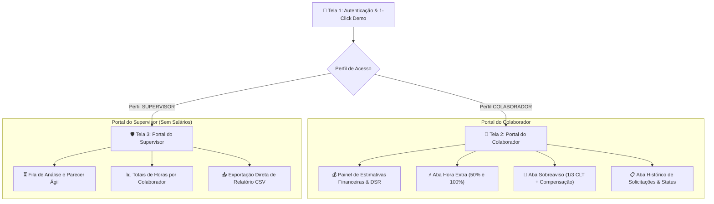

# ⏱️ Projeto Integrador: Gestão Inteligente de Horas Extras e Sobreaviso CLT

Documento de entrega do protótipo da solução proposta, descrição curta, fluxo de utilização e vídeo de apresentação desenvolvido com o recurso **Claude Remotion Skill**.

---

## 📄 1. Descrição Curta do Projeto

O **Sistema de Gestão de Horas Extras e Sobreaviso CLT** é uma aplicação web *full-stack* desenvolvida para automatizar o apontamento, a validação hierárquica e a apuração financeira de jornadas extraordinárias (50% e 100%) e escalas de sobreaviso. A solução elimina processos manuais e planilhas descentralizadas por meio de cálculos instantâneos em estrita conformidade com a Consolidação das Leis do Trabalho (**CLT**) e com o **Art. 244, § 2º**, implementando ainda uma política rigorosa de **privacidade e blindagem salarial (LGPD / RBAC)** que impede que supervisores tenham acesso à remuneração dos colaboradores.

---

## ⚠️ 2. O Problema Identificado

No ambiente corporativo e operacional (especialmente em equipes de Tecnologia da Informação, Suporte, Infraestrutura, Saúde e Indústria), o gerenciamento de trabalho extraordinário e plantões de sobreaviso enfrenta gargalos críticos:

1. **Processos Manuais e Planilhas Paralelas**: Anotações em papel ou planilhas descentralizadas levam a rasuras, perdas de histórico e retrabalho massivo no fechamento mensal do Departamento Pessoal.
2. **Erros nos Cálculos Legais da CLT**: Complexidade na apuração de adicionais diferenciados (50% em dias úteis e sábados; 100% em domingos e feriados; 1/3 do valor da hora no sobreaviso) e apuração do reflexo no Descanso Semanal Remunerado (DSR).
3. **Bitributação de Horas (Sobreaviso vs. Hora Extra)**: Falha frequente em abater o tempo de sobreaviso quando o colaborador é acionado para trabalhar durante o plantão, gerando pagamentos duplicados ou cálculos incorretos.
4. **Vulnerabilidade de Privacidade e LGPD**: Supervisores operacionais frequentemente tinham acesso acidental ou indevido aos salários-base dos colaboradores durante as aprovações de ponto, violando boas práticas de proteção de dados e gerando atritos internos.
5. **Risco de Passivo Trabalhista**: Falta de rastreabilidade, falta de parecer formal da liderança e ausência de comprovação de justificativas para auditorias.

---

## ⚡ 3. A Solução Proposta

Desenvolvemos uma plataforma corporativa centralizada, segura e intuitiva:

- **Automação Completa de Cálculos Trabalhistas**: O colaborador informa os horários e o sistema apura automaticamente a duração líquida, o adicional correto (50% ou 100%), o valor proporcional de 1/3 para sobreaviso e a estimativa do reflexo no DSR.
- **Compensação Cruzada Inteligente**: Ao registrar uma hora extra durante uma escala de sobreaviso na mesma data, o sistema deduz automaticamente o tempo trabalhado do sobreaviso, garantindo conformidade e eliminando duplicidades de pagamento.
- **Blindagem Salarial por RBAC (LGPD)**: Arquitetura em três camadas (Banco SQLite, API Express e Frontend) onde o supervisor tem visão estritamente orientada a **horas, justificativas e status**, sem jamais visualizar salários ou cifrões.
- **Workflow de Aprovação Rápido**: O supervisor analisa os motivos, aprova ou reprova com parecer explicativo e exporta relatórios operacionais em formato **CSV** para a folha de pagamento.
- **Facilidade de Demonstração (1-Click Demo)**: Botões integrados na tela de autenticação para login instantâneo como colaborador (*João*) ou supervisor (*Carlos*).

---

## 🎯 4. Público-Alvo

1. **Colaboradores e Plantonistas**: Profissionais sujeitos a horas extras ou escalas de sobreaviso (desenvolvedores, analistas de infraestrutura/suporte, engenheiros de campo, técnicos e profissionais de saúde).
2. **Supervisores, Coordenadores e Gerentes Operacionais**: Líderes de equipe que necessitam aprovar jornadas com agilidade, acompanhar o volume de horas da equipe e registrar pareceres técnicos.
3. **Recursos Humanos e Departamento Pessoal**: Profissionais responsáveis pelo fechamento de ponto, auditoria trabalhista e integração de relatórios operacionais consolidados.

---

## 🖥️ 5. Protótipo da Solução Proposta: Telas e Fluxo de Utilização

### 🗺️ Mapeamento Visual das Principais Telas



---

### 🔄 Fluxo de Utilização Passo a Passo

#### Passo 1: Autenticação e Seleção de Perfil
- O usuário acessa a aplicação em `http://localhost:3000`.
- Utiliza os atalhos de **1-Click Demo**:
  - `👤 Colaborador (João)`: Acesso com dados salariais pré-cadastrados (R$ 3.300,00 -> R$ 15,00/h).
  - `🛡️ Supervisor (Carlos)`: Acesso gerencial com controle de aprovação.
- Ou realiza o cadastro com escolha de cargo, salário base e carga horária (padrão 220h CLT).

#### Passo 2: Lançamento de Horas Extras (50% ou 100%)
- No Portal do Colaborador, na aba **Hora Extra**, o colaborador seleciona a modalidade:
  - **50%**: Dias úteis e sábados;
  - **100%**: Domingos e feriados;
- Define data de início, hora de início, data de término e hora de término (com suporte a viradas de madrugada).
- O sistema calcula a **Duração em Tempo Real**.
- Insere a justificativa obrigatória e clica em **Lançar Horas Extras**. A solicitação entra com status `🟡 PENDENTE`.

#### Passo 3: Escala de Sobreaviso com Compensação Cruzada
- Na aba **Sobreaviso**, o colaborador registra a escala em que ficou de prontidão.
- **Homologação Imediata**: O sobreaviso é homologado automaticamente.
- **Compensação Dinâmica**: Se houver horas extras na mesma data, o sistema abate o tempo equivalente das horas de sobreaviso, informando o colaborador instantaneamente.

#### Passo 4: Painel Financeiro e Acompanhamento
- O colaborador visualiza no topo seus cards de estimativa:
  - Salário base e valor da hora normal ($\text{Salário} \div 220\text{h}$);
  - Subtotais acumulados de H.E. 50%, H.E. 100% e Sobreaviso;
  - Estimativa do reflexo no **DSR**;
  - Total geral previsto e total garantido já aprovado.

#### Passo 5: Avaliação do Supervisor e Exportação CSV
- Ao alternar para o perfil de **Supervisor**:
  - O gestor visualiza os registros pendentes de todos os membros da equipe.
  - Clica em **Aprovar** ou **Reprovar**, inserindo um parecer explicativo.
  - Na aba **Totais de Horas**, visualiza o consolidado operacional da equipe.
  - Clica em **Exportar Relatório em CSV** para download do fechamento de folha.
  - **Garantia LGPD**: Em nenhum momento o supervisor vê salários ou estimativas financeiras.

---

## 🎬 6. Vídeo de Apresentação (Claude Remotion Skill)

O vídeo de apresentação foi desenvolvido em código TypeScript/React utilizando a composição do **Remotion** integrada no diretório [`video-apresentacao/`](file:///c:/Users/LUIS%20DOIDO/Desktop/curso%20IA/Projeto%20Integrador%20-%20Copia/video-apresentacao).

### 📊 Especificações Técnicas do Vídeo
- **Arquivo de Saída**: [`video-apresentacao/out/video.mp4`](file:///c:/Users/LUIS%20DOIDO/Desktop/curso%20IA/Projeto%20Integrador%20-%20Copia/video-apresentacao/out/video.mp4)
- **Duração**: 54 segundos (1.620 frames a 30 FPS)
- **Resolução**: 1280 x 720 (HD 720p widescreen)
- **Tamanho**: ~5,6 MB
- **Tecnologias**: React 19, Remotion 4.0, TypeScript, animações com `spring()` e `interpolate()`, paleta dark corporativa.

### 🎞️ Estrutura das Cenas do Vídeo

| Cena | Minutagem | Frames | Conteúdo Visual e Apresentação |
|---|---|---|---|
| **Cena 1** | `00:00 - 00:11` | 0 a 330 | **O Problema Identificado**: Planilhas manuais, riscos de cálculo na CLT (50%, 100%, sobreaviso) e vazamento de salários. |
| **Cena 2** | `00:11 - 00:22` | 330 a 660 | **A Solução Proposta**: Apresentação da plataforma centralizada, motor de cálculo CLT, Node.js + SQLite nativo e blindagem salarial LGPD. |
| **Cena 3** | `00:22 - 00:33` | 660 a 990 | **Portal do Colaborador**: Simulação financeira em tempo real, cards de 50%, 100%, 1/3 Sobreaviso e compensação cruzada imediata. |
| **Cena 4** | `00:33 - 00:44` | 990 a 1320 | **Portal do Supervisor & Governança**: Fila de aprovação ágil, parecer da liderança, zero visibilidade salarial e download em CSV. |
| **Cena 5** | `00:44 - 00:54` | 1320 a 1620 | **Conclusão & Impacto**: Eliminação de passivos trabalhistas, 80% menos tempo no fechamento de folha e conformidade integral com a LGPD. |

---

## 🎙️ 7. Roteiro de Narração para ElevenLabs (Voz Profissional)

Para quem desejar gerar a locução profissional no **ElevenLabs** (ou via MCP), segue o script formatado com timestamps sincronizados e indicações de entonação:

> **Voz Recomendada no ElevenLabs**: *Adam*, *Antoni*, ou voz em português como *Guilherme* / *Thiago* (Tom corporativo, firme e moderno).

```text
[00:00 - 00:11] (Tom sério e reflexivo)
"Gerenciar horas extras e plantões de sobreaviso por planilhas manuais ou papel gera sérios riscos de passivo trabalhista, erros frequentes nos adicionais da CLT e exposição indevida de dados salariais."

[00:11 - 00:22] (Tom entusiasmado e resolutivo)
"Para resolver isso, apresentamos nossa Solução de Gestão Inteligente de Jornada. Uma plataforma web integrada, construída em Node.js e SQLite nativo, que automatiza todos os cálculos trabalhistas e garante blindagem salarial rigorosa por LGPD."

[00:22 - 00:33] (Tom demonstrativo e claro)
"No Portal do Colaborador, o funcionário registra horas extras a 50% ou 100% e escalas de sobreaviso com compensação automática caso seja acionado. Tudo com estimativa financeira em tempo real e reflexo no DSR."

[00:33 - 00:44] (Tom seguro e profissional)
"Já o supervisor acessa um painel exclusivo para avaliar justificativas e aprovar horas em um clique, com exportação direta em CSV para a folha de pagamento — e total privacidade salarial, sem nenhum cifrão visível."

[00:44 - 00:54] (Tom conclusivo e impactante)
"Conformidade com a CLT, respeito à LGPD e eficiência para a sua empresa. Este é o nosso Projeto Integrador!"
```

---

## 🛠️ 8. Como Executar o Protótipo e Renderizar o Vídeo

### 1. Executar a Aplicação Web
No terminal, na pasta raiz do projeto:
```bash
npm start
```
Acesse no navegador: 👉 **`http://localhost:3000`**

### 2. Abrir o Remotion Studio (Pré-visualização Interativa do Vídeo)
No terminal, dentro da pasta `video-apresentacao`:
```bash
cd video-apresentacao
npx remotion studio
```
Acesse: 👉 **`http://localhost:3001`** (ou porta indicada no terminal) para assistir, pausar e navegar pela timeline do vídeo interativamente.

### 3. Renderizar Novamente o Vídeo em MP4 (caso deseje)
```bash
cd video-apresentacao
npx remotion render src/index.ts MyComp out/video.mp4
```
O arquivo de vídeo final em alta definição será gerado em: `video-apresentacao/out/video.mp4`.

